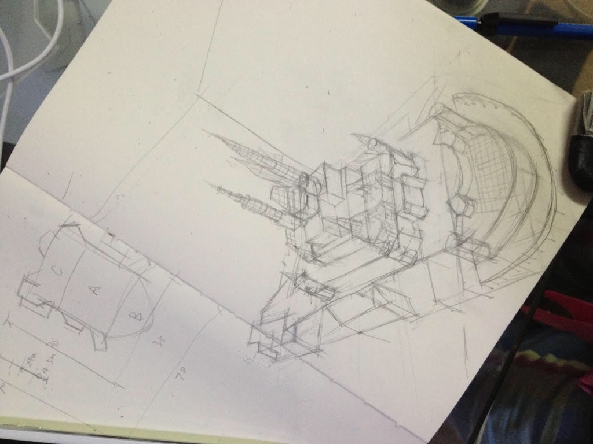

Pencil on paper. A perspective study of a castle: the spires first, then the base, then the plan view with measurements in the corner to check the proportions.

Found it in an old sketchbook. Posting it here so it stops living in a drawer.
