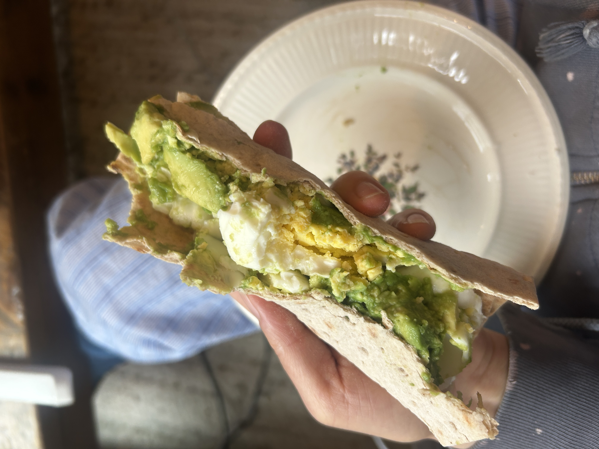

Breakfast: flatbread, avocado, chopped boiled eggs, a little salt. The eggs are from the farmers market, ten dollars for a dozen, and they taste the way eggs are supposed to taste.

Japanese supermarkets sell an egg sandwich where the egg is mixed with mayonnaise. I used to think that was the recipe. Now I think it is a patch. The mayo is there to add back a richness the eggs never had. If the eggs are good, you don't need it. I am not sure we need mayonnaise in our lives at all.

The price argument doesn't hold up either. A dozen supermarket eggs costs less than the farmers market dozen. Then you buy the mayonnaise to make them taste like something, and the total is not cheaper anymore. People mixing mayo into cheap eggs think they got a bargain. They didn't.

Mass production made food cheaper by making it worse. I would rather see regional producers make real food and charge what it costs.
