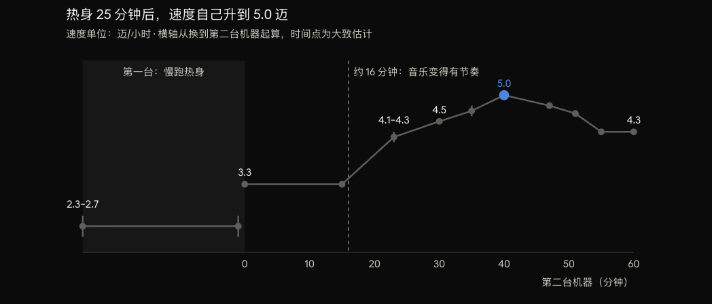

Today's run was the best state I have found so far. About 85 minutes in total, up to 5.0 mph, and none of it felt hard.

## How it went

I started on one treadmill and jogged very slowly for 23 to 25 minutes, at 2.3 to 2.7 mph.

Then I moved to a second treadmill. For the first 15 minutes I stayed at 3.3 mph, and even that felt like work. Early on I wanted to go above 3.3, but I couldn't, so I didn't force it.

Around 16 or 17 minutes, the fashion show I was playing switched to music with a strong beat. I was warmed up by then, and the music seemed to wake my brain up. My whole body started to want to run faster. It wasn't me pushing. The body wanted it on its own.

- 23 minutes: 4.1 to 4.3 mph
- 30 minutes: 4.5 mph, without effort
- after 30 minutes: 4.6 to 4.8 mph
- 40 minutes: 5.0 mph
- 45 to 50 minutes: back down to 4.8
- last 9 minutes: 4.7, 4.6, then 4.3 for the final 5 minutes

## How it felt

While I was speeding up to 4.5, I shouted a few times. That wasn't strain. I just needed a big breath of air so badly that it came out as a shout. The whole thing was smooth.

Between 4.6 and 5.0 I didn't feel any effort, and the time didn't feel long. I breathed in big from my chest, and the air seemed to rise all the way to my head. I could feel oxygen going into my brain, and the brain fog from studying all day got washed out. My head felt relaxed and happy.

I could also feel the oxygen going out to my arms and legs, giving them energy to keep running. Something like a current spread out from my chest. My body seemed to learn how to move as one piece and knew where to put its force. The movement was strong and smooth at the same time. I was in a flow.

## What I learned

This is my best state. This is the whole process I need, no more and no less.

The 23 to 25 minutes of slow jogging at the start make complete sense for me. Most people would think that warm-up is far too long. I just need that much time.

It's okay, I am slower. I only care that it brings out my best state. I don't care whether my best state is better than anyone else's. It is mine. I'm not competing with anyone. I'm okay to lose if I run slower than others.

## About racing

This run showed me a problem I've had since I was a kid. I used to love running. When I started racing, I still placed near the front, but running had already changed. I kept checking the person next to me to see if they were faster. When I met someone really strong, I shrank.

I lost for two reasons. First, I wasn't focused on my own state. I was busy caring how fast other people were, and that got in the way of bringing my own state out. Second, looking back, even at my best I probably couldn't have beaten the best runners. Some of that is born, not made. Still, I don't care about the championship. I only care about bringing out my own best running state.

I could have enjoyed every run. Each one was my own experience and my own pleasure. Racing pulled my attention away, and I missed a lot of runs where I could have had my best state. That is a real loss.

Races try to cut out each person's best state and compare them, to see how far humans can go. Now that I know my own process, that seems pointless to me. When the gun goes off, everyone has to be at their best at that exact moment. Whoever has a bad day loses. So a race doesn't only measure your best state. It also measures whether you can trigger it on that day, with music or whatever else you can find. I don't see the point of forcing that state on cue.

I just want to enjoy my run.
